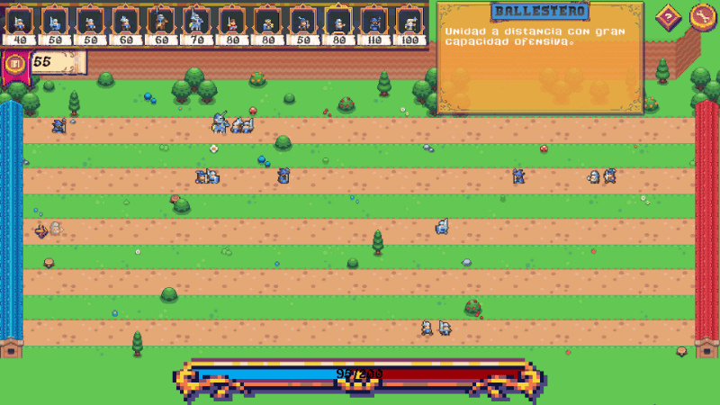

# Minieval Warfare 🛡️⚔️

Un juego de estrategia en tiempo real 2D (*lane-based / tug of war*) desarrollado en **Unity** (v. 6) para la asignatura de Sistemas Multimedia (Grado en Ingeniería Informática, Universidad de Valladolid).

## 🎮 Descripción del Gameplay
El jugador asume el rol de un estratega militar en un mundo de fantasía medieval. Gestionando una economía progresiva (Arcas Reales), deberá desplegar de forma inteligente tropas especializadas a través de un sistema de carriles (filas) para superar las líneas enemigas y dominar el medidor de victoria antes de que se agote el tiempo límite.

## ✨ Características Técnicas & Mecánicas
*   **Inteligencia Artificial (IA) Modular:** Sistema de comportamiento autónomo donde las unidades detectan colisiones, ceden el paso a unidades aliadas, seleccionan objetivos (cuerpo a cuerpo y distancia) y entran en combate.
*   **Economía y Balanceo (Riesgo/Recompensa):** Generación de recursos escalonada diseñada para evitar estancamientos (*snowballing*), equilibrada a través de *cooldowns* de invocación y un medidor asimétrico de victoria.
*   **Arquitectura de Datos (Scriptable Objects):** Uso intensivo de *Scriptable Objects* para centralizar las estadísticas (Vida, Armadura, Daño, Velocidad, etc.) de los 12 tipos de tropas, facilitando el balanceo e iteración del diseño sin recompilar.
*   **IA Enemiga Dinámica:** Algoritmo de decisión táctica que evalúa el "nivel de peligro" por fila según las tropas presentes, priorizando carriles amenazados o indefensos para lanzar contraataques.
*   **UX/UI & Feedback Sonoro:** Interfaz de usuario rica (tooltips dinámicos de tropas), integración total de SFX por eventos (magia, espadas) y música ambiental en bucle mediante gestores de audio.

## 🕹️ Demostración

*Invocación estratégica de infantería, control de terreno e IA enemiga evaluando prioridades.*

## 📂 Documentación y Diseño (GDD)
El diseño completo del juego, la planificación de mecánicas, curvas de dificultad, requisitos técnicos, justificación de biomas y licencias de arte *Pixel Art* están recogidos en el **Game Design Document (GDD)**. 

📄 **[Leer GDD Completo (PDF)](./Docs/GDD_MinievalWarfare.pdf)**

## 🛠️ Stack y Entorno de Desarrollo
*   **Motor:** Unity (versión 6) - 2D URP.
*   **Lenguaje:** C# (Patrón Componente, Máquinas de Estado, Events).
*   **Assets y Arte:** Sprites de [Itch.io](https://itch.io) (Licencias de libre uso - ver GDD para créditos completos).
*   **Herramientas Externas:** Draw.io (esquemas lógicos), SLK_img2pix (edición visual).
